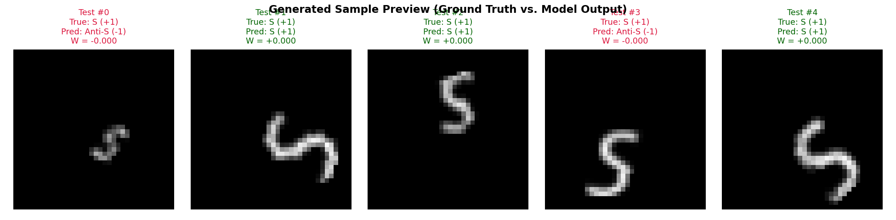
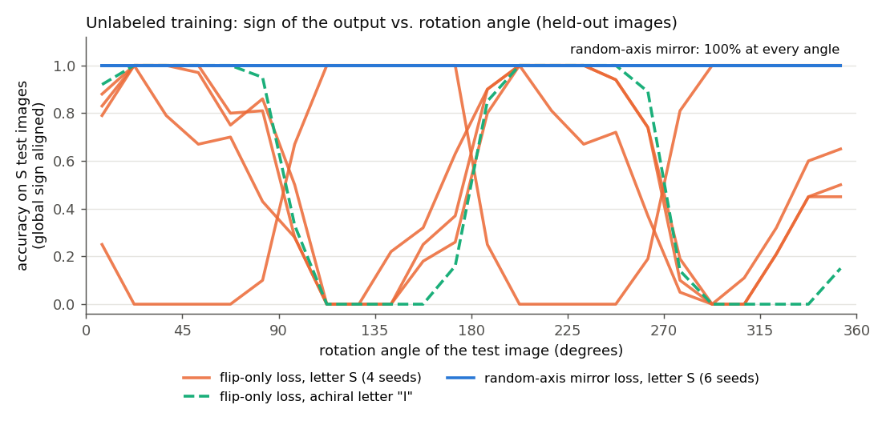
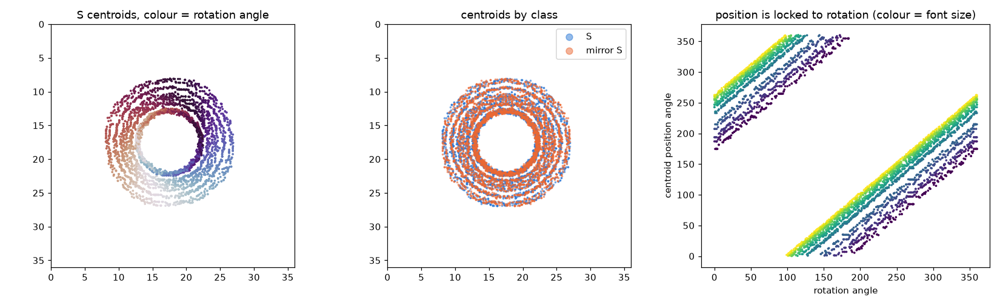
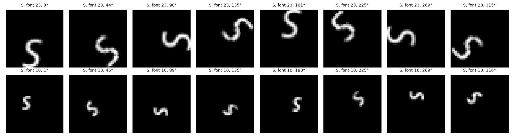

# Why the unlabeled chirality training failed, and the fix

## Summary

The network could tell S from mirror-S when given labels, but not without them. There were two separate problems:

1. **The loss had the wrong sign.** The training loss was being *minimized*, so the network learned to output 0 for every image.
2. **Even with the sign fixed, the objective did not define chirality.** "Changes sign under a left–right flip" is also true of a much simpler feature: whether the shape leans `/` or `\`. The network learned that instead.

The fix is to mirror about a **random axis** (horizontal flip followed by a random rotation) inside the loss, instead of always using the horizontal flip. With that change, the unmodified `test_unlabeled_model.py` reports **100 % accuracy**.

| Loss | Test accuracy | mean \|W\| |
|---|---|---|
| Original code (minimized, see below) | 53.6 % | 0.000 |
| Maximize $(S(x) - S(\mathrm{flip}\,x))^2$, fixed horizontal flip | 56.0 % | 0.999 |
| **Maximize $(S(x) - S(M_\phi x))^2$, mirror about a random axis** | **100 %** | **1.000** |

These are TensorFlow runs of this repo's model and data: 12 epochs, training data seed 42, test data seed 43 as in `test_unlabeled_model.py`. A test accuracy near 50 % means chance.

## Setup (recap)

`build_antisymmetric_cnn` computes $f(x) = \tanh\big(g(x) - g(\mathrm{flip}\,x)\big)$ after centering the image, where $g$ is a CNN. So $f(\mathrm{flip}\,x) = -f(x)$ by construction. This is the symmetrized $S_\mathrm{sym}$. The trainer never sees the labels.

## Problem 1: the loss was minimized

The old `train_step` used

```python
blind_loss = tf.reduce_mean(tf.square(tf.abs(P_orig - P_mirror) / 2.0 * 0.5))
```

Since the model already gives `P_mirror = -P_orig`, this is $P^2/4$. Minimizing it drives the output to zero. The README formula had `- 0.5` where the code has `* 0.5`. The committed results from that version show every test output at W = ±0.000, so the 58 % accuracy was noise:



## Problem 2: changing sign under one mirror is not chirality

The natural repair is to maximize $(S(x) - S(\mathrm{flip}\,x))^2$, i.e. minimize $-\langle S_\mathrm{sym}^2\rangle$. That loss trains perfectly: |W| → 1 on held-out images. But the accuracy stays at chance.

The reason is that the loss only asks for a function that changes sign under **the horizontal flip**. Chirality does that, but so does *tilt*. A horizontal flip turns a shape leaning `/` into one leaning `\`. Tilt is a low-level orientation feature that a CNN picks up much more easily than handedness, so that is what it learns.

The evidence is in the per-angle accuracy of the trained network:



- With the fixed horizontal flip (orange), the output sign is set by the rotation angle, not by the handedness. It repeats every 180° and flips roughly every 90°, which is the signature of tilt.
- **Control (green, dashed):** the same loss trained on the letter "I", which has no chirality at all, still reaches |W| = 0.99, with the same 90° pattern. So the loss can be fully satisfied without any chirality in the data.

The loss is also blind to sign. Swapping the sign for any subset of images, together with their mirrors, leaves it unchanged. Nothing in it says that S at 0° and S at 90° belong to the same class.

## The fix: mirror about a random axis

Chirality is a property that changes sign under **every** reflection, not just one. Any rotation is the product of two reflections. So a function that changes sign under every reflection is automatically unchanged by rotations, and its sign is the same for all rotated copies of an S.

A reflection about an arbitrary axis is a horizontal flip $F$ followed by a rotation $R$, so the change to `train_step` is:

```python
X_mirror  = self.random_rotation(tf.image.flip_left_right(X), training=True)   # M = R F
blind_loss = -tf.reduce_mean(tf.square((P_orig - P_mirror) / 2.0))
```

Why this works. Because $f$ already changes sign under $F$, and $RF = FR^{-1}$:

$$
f(Mx) = f(F R^{-1} x) = -f(R^{-1}x)
\quad\Rightarrow\quad
\mathcal{L} = -\tfrac14\big\langle (f(x) + f(R'x))^2 \big\rangle
= -\tfrac14\langle f(x)^2\rangle - \tfrac14\langle f(R'x)^2\rangle - \tfrac12\langle f(x)\,f(R'x)\rangle,
$$

where $R' = R^{-1}$ is a random rotation. The loss splits into a **magnitude** term and a **rotation-consistency** term:

- A consistent chirality detector ($f = \pm 1$, same sign for all rotations) reaches $\mathcal{L} = -1$.
- The tilt solution is uncorrelated with its own rotated copy, so it reaches only about $-\tfrac12$.
- $f \equiv 0$ gives $\mathcal{L} = 0$. That is not a minimum: any nonzero output lowers the loss unless $f(R'x) = -f(x)$ exactly.

Using only the consistency term, $-\langle f(x) f(Rx)\rangle$, is not enough. A randomly initialized network is not consistent under rotation, so shrinking $f$ lowers that loss, and training can get stuck at $f \approx 0$. In the replica runs below, that happened on 3 of 6 seeds. The magnitude term prevents it.

### Results (PyTorch re-implementation, same generator, architecture and training settings)

| Loss | Seeds | Test accuracy | mean \|W\| |
|---|---|---|---|
| Original code | 1 | 50 % | ~1e-4 (collapsed in epoch 1) |
| README formula $(\lvert P - P_m\rvert/2 - 0.5)^2$ | 1 | 51 % | 0.49 |
| Fixed horizontal flip, $-\langle S_\mathrm{sym}^2\rangle$ | 4 | 50–56 % | ≈ 1 |
| Rotation consistency only, $-\langle f(x)f(Rx)\rangle$ | 6 | 100 % on 3 seeds | 3 seeds collapse to < 0.001 |
| **Random-axis mirror** | 6 | **100 % on all 6** | ≈ 1 |
| Labeled (reference) | 1 | 100 % | 1 |

### What the loss still does not fix

- **Global sign.** Which handedness is called +1 is arbitrary. `test_unlabeled_model.py` already handles this by flipping the sign if accuracy is below 50 %.
- **Sign across font sizes.** Rotations and reflections never turn one font size into another, so the loss would allow a different sign convention per size. In practice the network uses the same local features at every size, and all six runs were consistent. It is not guaranteed by the objective, though.

## Data audit: is the data truly random?

Rotations are random. Translations are not, and there are a few other quirks. None of these caused the failure above, but they matter for interpreting results.



- **No random translation.** The glyph is always drawn at (10, 10) on a 35×35 canvas and then rotated about the canvas centre. Its centroid therefore sits on a circle whose radius is set by font size (4.9 px at size 10, 9.4 px at size 23). Its position on that circle is locked to the rotation angle (right panel). S and mirror-S occupy the same positions (middle panel), but position *together with* orientation would identify the class. `CenterOfMassAlignLayer` removes this cue, so keep it unless real random shifts are added.
- **Clipping.** `randint` is inclusive, so font sizes run 10–23. At sizes 22 and 23, 32 % and 65 % of images have the glyph cut off by the border:

  

- **Few distinct images, and train/test leakage.** Font size and angle are integers, which gives only 14 × 361 = 5054 possible images per class (0° and 360° are identical). The 5000 training S images contain only 3013 distinct images, and **65 % of the test S images are pixel-identical to a training image**. The test set is therefore mostly not held out. That matters most for the labeled baseline, which could simply memorize.
- **Exact mirror pairs.** Every mirror-S is the exact pixel mirror of an S in the same set (max difference 0), and the classes are exactly balanced.
- Rotation uses PIL's default nearest-neighbour resampling, so edges are jagged in an angle-dependent way. This is harmless for chirality because the mirror is exact.

Possible improvements to `generate_synthetic_data` (not implemented):

- Centre the glyph (e.g. `anchor="mm"` at the canvas centre), then apply a random, possibly sub-pixel, translation.
- Use continuous angles and bicubic rotation.
- Cap the font size or enlarge the canvas so nothing is clipped.
- Build the test set from parameters not seen in training (e.g. held-out font sizes), or at least deduplicate it against the training set.
